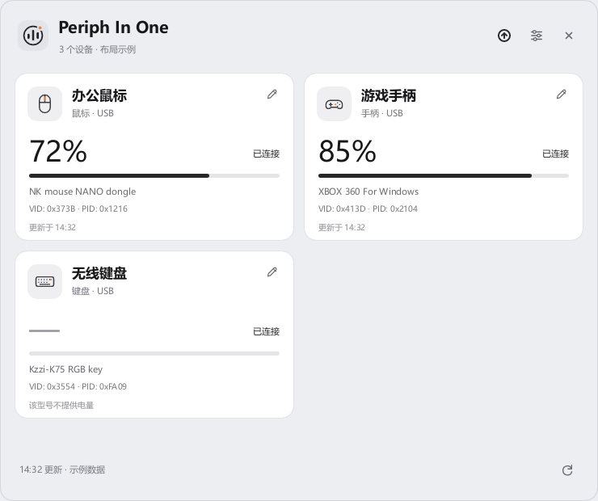
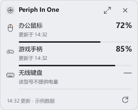
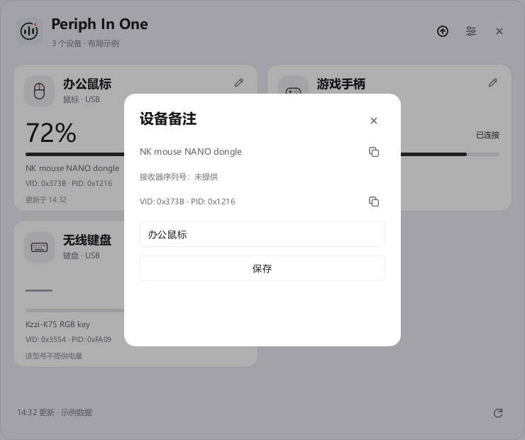
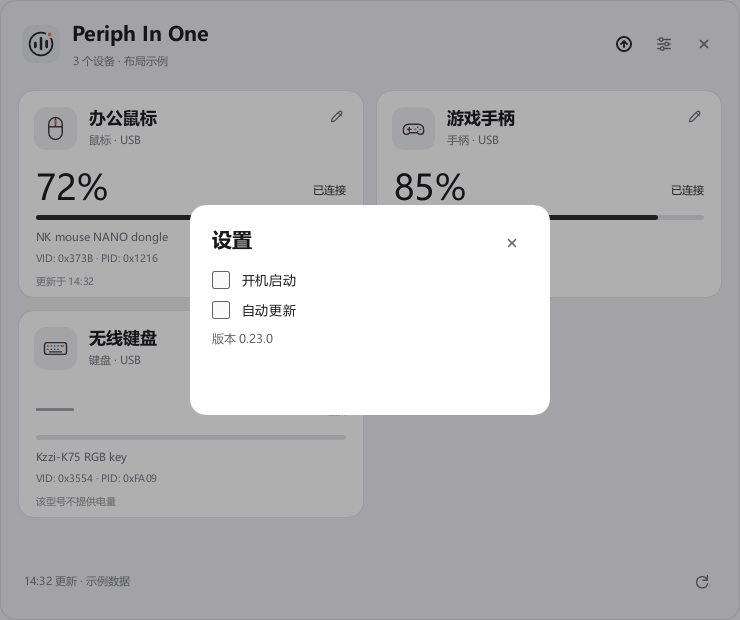

<p align="center">
  
</p>

<p align="center">
  <a href="https://github.com/FoLeaf/Periph-In-One/releases">发布</a> ·
  <a href="#支持的设备">设备兼容</a> ·
  <a href="#从源码构建">源码构建</a> ·
  <a href="contribution.md">参与贡献</a>
</p>

**Periph In One** 是面向 Windows 10/11 x64 的便携外设电量工具。把支持的 2.4G 接收器接到电脑，即可在一个面板里查看电量；收起窗口后，从系统托盘随时唤出。

Rust + Slint，使用软件渲染，无需 Python 或 WebView2 运行时。当前版本 **0.21.0**。

## 界面一览

以下图片由当前 Slint 界面直接渲染，使用明确标记的演示数据。百分比用于展示布局，不代表设备实测结果。

### 完整面板

窗口可缩放，设备卡片随宽度自动排列。保留上次读数与更新时间，区分在线、未响应与离线；在线但不提供电量的设备显示 `—`。



### 托盘微缩面板

双击托盘图标查看紧凑列表，支持刷新、滚动和展开。

<p align="center"></p>

<details>
<summary>设备备注与设置</summary>

为设备设置备注，查看并复制硬件标识；设置中可切换开机启动。





</details>

## 开始使用

1. 从 [Releases](https://github.com/FoLeaf/Periph-In-One/releases/latest) 下载 Windows x64 ZIP 并解压。
2. 在可写目录运行 `periph-in-one.exe`，连接支持的接收器。
3. 关闭窗口会收起到托盘。双击托盘图标打开微缩面板；完全退出使用托盘右键菜单中的“退出”。

- 启动时立即读取，之后每 60 秒刷新；也可手动刷新。
- 设备备注、历史电量与窗口尺寸保存在 EXE 同级的 `config/settings.json`。移动程序时一起移动 `config/`。
- 旧配置自动迁移，保留备注与历史；首次保存前生成 `settings.json.v1.bak` 原文件备份。
- 开机启动默认关闭，可在设置中开启。自启时直接进入托盘。
- 默认不联网、不遥测、不写日志；配置文件包含本机设备信息，请勿公开上传。

## 支持的设备

当前按接收器与协议匹配，**不代表支持同品牌的所有产品**。蓝牙只读取 Windows 已收到的音频设备电量，通用 HID 电量读取尚未实现。

| 设备 / 接收器 | 匹配标识 | 当前边界 |
| --- | --- | --- |
| ATK / VXE 鼠标（FF05 家族） | VID `373B`，Usage Page `FF05:0001`，89 个 PID（`1216` 实测，另有 `FF02` 回退接口） | `1216` 已有电量实测记录；其余 PID 取自 ATK HUB 设备表，已实现未实测 |
| ATK V2 鼠标（FF04 家族） | VID `373B` / `3554`（Dragonfly），Usage Page `FF04:0002`，共 191 个 PID | 协议取自 ATK HUB 静态分析（feature report），已实现未实测 |
| VXE / ATK V2 无线接收器（FF02 家族） | VID `3554`，`FF02:0002`，9 个接收器 PID | PR #3 作者已实测 VXE R1 SE+ 1K Dongle（`F58E`）电量与 RF 身份；其余 PID 已实现未实测。优先使用 FF02 接口，接收器未连接鼠标时保留断开状态 |
| 罗技 Unifying 家族接收器（LIGHTSPEED / Unifying / Bolt） | VID `046D`，Usage Page `FF00` / `0x01` + `0x02`，HID++；LIGHTSPEED `C539`/`C53A`/`C53D`/`C53F`/`C541`/`C545`/`C547`/`C54D`，Unifying `C52B`/`C532`，Bolt `C548` | 读配对数后以长帧设备通道逐槽探测，一拖多接收器每个在线设备各占一条记录（与 Solaar、OpenLogi 同一协议族，扫描过程无寄存器写入）；G502 LIGHTSPEED 电量实测走 Battery Voltage (0x1001) 毫伏读数，按 Solaar 同款锂电放电曲线换算百分比，另支持 Unified Battery / Battery Level Status 设备；Unifying、Bolt 及其余 LIGHTSPEED 接收器为已实现未实测；仅支持 HID++ 2.0 设备，HID++ 1.0 时代的老设备不响应长帧 Ping；设备仅在被操作时保持链路，休眠或离线时提示确认开机 |
| 蓝牙音频耳机（SOUNDPEATS Space、Redmi Buds 6 等经典音频设备） | 蓝牙音频设备（BTHENUM），系统连接标志 + 免提节点电量属性 | 读取 Windows 已收到的 HFP 电量；已连接且有值时显示系统读数，缺少连接证据保持未知，断开后保留历史；已有真机电量实测记录，本次 HAL 迁移未复验蓝牙电量 |
| DARKRIM SHADOW 耳机 | `3654:6901`，`FF02:0002` | 已实现协议与解析测试，待补当前版本真机验收 |
| iKF USB 耳机 | VID `38B1`，Usage Page `FF00:0001`（含 `3412` / `3419` 等 PID） | 协议取自 iKF Audio 静态分析；V11 Pro（`3419`）已有电量实测记录；其余 PID 已实现未实测 |
| KZZI / Compx 键盘（含狼蛛 AULA F75 / F87 / F99 / F87 Pro 等同方案接收器） | `3554:FA09`，`FF02:0002` | K75 身份识别已验证；该机固件不提供电量，显示为已连接与 `—`；狼蛛 F87 Pro 已实测电量与型号识别（状态字节为电池供电，型号签名取自设备应答），F75 / F87 / F99 无线版取自 AULA Hub 设备表、已识别未实测；MCHOSE G75 / G98 / X75 / GX87 等共用该接收器（G75 已实测电量）；其他型号电量粒度依固件而定 |
| 狼蛛 AULA 新款无线键盘（F87ProV2 / F108ProV2 系等 Dongle） | VID `0C45`，PID `FEFC` / `FEFE` / `FEF9`，Usage Page `FF60` / `FF67` / `FF68` / `FF70` / `FF80` | 帧格式取自 Aula Hub 2.2.3 反混淆分析（32 字节命令帧 + CRC-16/CCITT-FALSE，电量命令 0x11 回退 0x51），已实现未实测——插上 Dongle 后即可读数，异常时反馈报错；老款固件如有其它 PID 暂不匹配 |
| BIGBIG WON / Zikway 手柄 | VID `413D`，`FF7A:0001`；已观察到 PID `2104` / `2106` | 烈风 GALE 已有电量实测记录；待机或未连接时可能不响应，唤醒后可重试 |

读取失败时保留历史电量并显示读数时间；没有历史值时显示 `—`。设备名称可能是接收器名称。接收器序列号不等于外设本体序列号；缺少可靠序列号时，换 USB 插口可能影响备注匹配。蓝牙设备没有 HID 序列号，以蓝牙地址作为物理标识。

## 从源码构建

硬件适配已独立为 [periph-hal](crates/periph-hal/README.md)。应用直接使用通用设备记录，先发现设备，再独立读取所需能力；设备核心不要求电池或 USB 标识。分层与扩展边界见 [架构说明](docs/HARDWARE-ARCHITECTURE.md)，新增协议、后端和设备的流程见 [适配规范](docs/ADAPTATION.md)。

需要 **Windows x64、Rust 1.92+**。MSVC 工具链需安装 Visual Studio Build Tools 的“使用 C++ 的桌面开发”和 Windows SDK；GNU 工具链需可用的 MinGW-w64 链接器、`windres` 和 `ar`。依赖版本以提交的 `Cargo.lock` 为准。

```powershell
git clone https://github.com/FoLeaf/Periph-In-One.git
cd Periph-In-One
cargo test --workspace --locked --all-targets
.\scripts\build-windows.ps1
.\target\release\periph-in-one.exe
```

创建便携 ZIP：

```powershell
.\scripts\package.ps1
```

生成 `dist/periph-in-one-0.21.0-windows-x64.zip`，包含程序、文档、图片、校验和与依赖许可，不包含本机配置。默认从 `target/release/` 取程序，可通过 `-Executable` 指定其他构建路径；已有同名 ZIP 时会拒绝覆盖。

GitHub Actions 在分支 push / PR 时执行格式、Windows MSVC 测试、Clippy、Release 构建和打包，产物保留 14 天。推送与 Cargo 版本一致的 `v*` 标签会复用完整检查，生成附带 ZIP 和 SHA256 的 Release 草稿，真机验收后手动公开。详见 [CI / CD 流程](.github/CICD.md)。Windows 10、多屏和不同 DPI 场景仍需要真机验证。

<details>
<summary>命令行诊断</summary>

```powershell
# 枚举当前支持的接收器标识，输出 JSON，不发送电量查询
.\target\release\periph-in-one.exe --list-devices

# 读取一次设备电量，不打开窗口
.\target\release\periph-in-one.exe --once
```

Release 程序使用 Windows GUI 子系统；在需要读取命令输出时通过管道获取，例如 `--list-devices | Out-String`。

</details>

## 开发与贡献

从 [contribution.md](contribution.md) 开始。欢迎提交设备适配、协议测试与界面改进；新设备请附脱敏后的 VID/PID、接口和可复现的读数证据。

```text
crates/      独立 HAL、平台访问与协议实现
src/         应用身份、电量历史、配置、展示与 Windows 集成
ui/          Slint 页面与控件
assets/      应用图标和 README 图像
examples/    设备扫描与 README 截图生成
scripts/     PowerShell 构建与打包
licenses/    第三方许可
```

## 许可证与依赖

项目原创代码与文档采用 [MIT](LICENSE)。第三方组件保留各自的许可；Slint 按 [Royalty-free 2.0](licenses/Slint-Royalty-Free-2.0.md) 使用，分发时需遵守其署名条件。

[](https://slint.dev/)

设备访问使用 [hidapi](https://github.com/ruabmbua/hidapi-rs)，托盘使用 [tray-icon](https://github.com/tauri-apps/tray-icon)，Windows 集成使用 [windows-rs](https://github.com/microsoft/windows-rs)。
