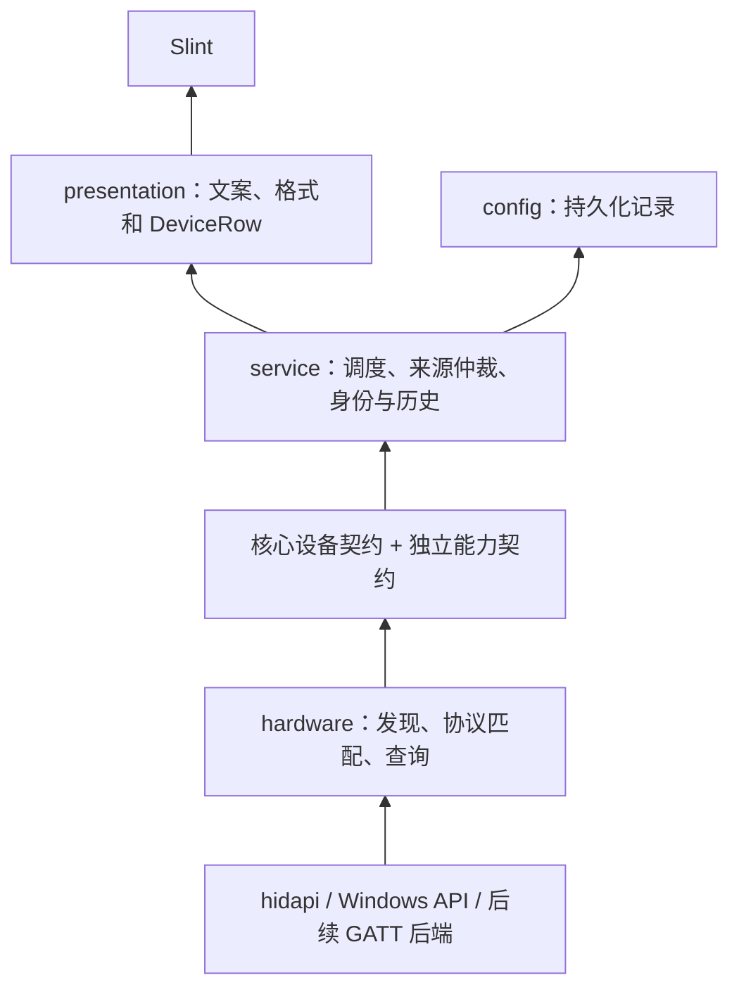

# 硬件适配与应用业务分层设计

状态：长期设计及首期实现边界。2026-10-25。

首期已拆出仓库内独立 Rust 库 `crates/periph-hal`，提供不依赖操作系统的 Backend、设备描述、连接事实及类型化能力注册，Windows HID/经典蓝牙后端已迁入，当前应用通过兼容层调用。实际使用与扩展方法见 [库说明](../crates/periph-hal/README.md)。

以下事件式来源、完整组件关系、能力会话生命周期与更多领域服务仍是后续设计，不能视为已完成实现。当前使用同步 inventory/scan 接口，来源按序执行；连续数据会话、热插拔推送和可取消调度待实际需求落地。首期仅落地电量观测，通过下游伪摄像头能力验证可扩展性；本轮未实现摄像头或媒体功能。

根据后续共同确认，公共核心和后端已选择独立 crate 的边界，取代本文早期“同一 crate 先拆模块”的暂定路径。应用配置格式保留，身份与备注业务留在原应用。

原设计依据：`ecad9c6` 和 PR #2（`a0c53e3`，合并提交 `d290057`）的蓝牙系统属性与 HID++ 多槽位需求。首期实际实施基线为已包含该 PR 的 `8b07ec9`。

## 1. 目标与边界

目标外设包括键鼠、耳机、数位板、手柄、摄像头及未来其他领域。设备无需具有电池、按键、USB 标识或某个固定的设备类别，才能进入管理体系。

硬件层负责发现端点、选择协议、管理访问资源和报告事实。应用层负责设备记录、身份归并、备注、历史读数、刷新策略与展示状态。新增已有能力的协议不应要求应用层识别该协议，也不应在 Slint 中增加厂商判断。

统一边界由两部分组成：稳定的设备核心契约，以及按领域独立的能力契约。USB HID、蓝牙系统属性与 BLE GATT 可以通过完全不同的 API 提供同一种能力，无须实现相同的字节流接口。电量是第一个能力模块，不是核心设备结构的必填属性。

首期只迁移现有只读电量能力，不实现 BLE、动态插件、通用 RPC 或灯效配置框架。后续若新增写能力，再定义独立命令契约；不要提前加入任意字节写接口。

通用性的边界是“稳定设备核心 + 可独立增加的能力模块”。键鼠输入、音视频流、固件升级和文件传输具有不同的吞吐、生命周期和失败语义，分别使用领域接口。新增已有能力的协议实现应不改业务；新增产品能力则增加对应契约、业务和交互，不要求给所有设备加方法，也不要求扩充核心请求/事件枚举。

## 2. 当前耦合及影响

| 位置 | 当前情况 | 影响 |
| --- | --- | --- |
| `vendor::VendorAdapter` | 接口暴露 `HidApi` / `DeviceInfo` | 只能抽象 HID 产品线，蓝牙系统属性无法接入 |
| `vendor::Outcome` | 返回最终 UI 文案，`no_battery` 同时参与在线判断 | 适配器承担展示决策；读取失败与不支持难以区分 |
| `devices.rs` | 混合 Windows API、接口分组、协议分发和 Reading 构造 | 新增一种数据源需要修改扫描核心 |
| `model::Reading` | 强制 VID/PID，设备类别混入 `bt-headset` | 身份和设备类别受传输方式影响 |
| `model::Device` / `app.rs` | `fresh` 同时表示在线、可用电量和成功读取 | 在线但缺少本轮电量时，历史值可能被当成当前值 |
| PR #2 多槽位 | physical_id 是否带槽号取决于本轮结果数量 | 同一槽位的路由键会随其他设备上下线变化 |

现有 `protocol.rs` 已经是纯报文函数，可继续复用。身份冲突保护、历史保留和配置原子保存也应保留其行为，不必重写已验证的逻辑。

## 3. 依赖方向



图中箭头表示数据流。代码依赖上，`hardware` 与 `service` 都依赖纯类型模块 `contracts`，二者不互相依赖；`hardware` 不引用 `service`、`config`、`presentation` 或 Slint。由应用启动代码装配来源和服务。

`contracts` 中既定义事实类型，也定义来源消息与生命周期契约。业务只使用该契约；不能因为 trait 定义在 hardware 中而反过来引用硬件实现模块。契约由应用需要的稳定能力定义，不能为了迁就某厂商 SDK 透传其对象或参数。

核心设备服务只依赖 core 契约。电量、音频、数位板、手柄或摄像头各自的业务服务依赖相应能力契约，不互相依赖。硬件后端可实现多个能力，具体实现和各领域服务只在启动装配处连接。领域业务和硬件适配器均不能反向修改设备核心的职责。

## 4. 模块组织

按已确认的复用边界，首期采用单仓库 workspace，将硬件库与应用拆成两个 crate，不引入动态加载。以下为长期逻辑职责示意；已落地的实际路径以独立库 README 为准。

```text
src/
  contracts/
    core/                      # 描述、身份、拓扑、能力目录、来源生命周期
    battery.rs                 # 首期唯一落地的领域能力契约
    # audio/、pen/、gamepad/、camera/ 等待需求落地时独立增加
  hardware/
    mod.rs                     # 后端构建与注册，启动代码注入设备源及能力端口
    hid/
      mod.rs                   # HidSource，枚举、端点分组与分发
      transport.rs             # open_pair / send / drain / KzziLink
      adapters/                # 现有 vendor 适配器；HID 类型止于这一层
    windows_bluetooth_audio.rs # Windows 缓存属性数据源，不模拟报文协议
  protocol.rs                  # 保留纯报文构造、解析；规模增大后再按家族拆分
  service/
    mod.rs                     # 刷新入口、来源工作线程与结果仲裁
    identity.rs                # 将身份/路由证据绑定到应用 DeviceId
    devices.rs                 # 仅管理核心设备状态；不直接持有电量/相机状态
    battery.rs                 # 电量事实、历史和多来源仲裁
    # 后续领域服务依赖各自能力契约
  presentation.rs              # DeviceRow、状态文案、时间与标识格式
  config.rs                    # 配置版本、序列化与原子保存
  app.rs                       # 事件连接、窗口和托盘生命周期
```

`contracts/core` 只依赖标准库及确有需要的序列化类型，不包含 `HidApi`、Windows 句柄、Slint 类型、领域载荷或中文状态文案。领域契约依赖 core，core 不依赖任何领域契约。先用模块可见性限制边界，暂不为此新增依赖。能力契约按关注点组织，不能逐渐长成包含所有设备功能的巨型模块。

## 5. 硬件层对外接口

顶层按数据获取方式注册后端，例如 HidBackend、WindowsBluetoothAudioBackend，以后可增加 BleGattBackend 或媒体后端。每个后端提供设备发现/生命周期来源，并按其真实实现提供零到多个能力端口。HardwareSource 专指设备核心的来源接口，不包揽所有领域通信。厂商与报文协议留在后端内部，不再成为软件业务的分支条件。

下列 Rust 为接口草图，相关类型含义见后文，不是已落地 API：

```rust,ignore
// 定义于 contracts，硬件实现它。由启动代码在适合的执行环境中创建来源。
pub trait HardwareSource {
    fn run(self: Box<Self>, ctx: SourceContext) -> SourceExit;
}

pub enum SourceRequest {
    Inventory(RequestContext),
    RefreshDiscovery(RequestContext),
    Stop,
}

pub enum SourceEvent {
    Inventory(InventoryBatch),
    Snapshot(SourceBatch),
    Updated(ObservationDelta),
    HealthChanged(SourceHealth),
}

pub struct SourceBatch {
    pub source: SourceId,
    pub generation: u64,
    pub scopes: Vec<ScopeReport>,
    pub observations: Vec<DeviceObservation>, // 仅设备核心事实，不放电量/帧数据
    pub issues: Vec<HardwareIssue>,
}
```

`SourceContext` 提供稳定 SourceId、请求接收端和事件发送端；请求包含关联 ID、刷新 generation、单调时钟 deadline 和取消信号。每次重试使用剩余预算，不能每轮重置超时。单个来源失败不丢弃其他来源的结果。该接口不要求异步运行时；现有同步枚举可在来源内部消费 RefreshDiscovery，再发送 Snapshot。

Inventory 是被动标识枚举，不发送设备查询报文；系统无法被动识别的信息保留未知。RefreshDiscovery 只刷新设备发现与生命周期信息。电量刷新等领域操作走相应能力端口，后端可明确返回不支持主动刷新，不能将本地缓存冒充重新采样。订阅型后端可独立发送 Updated；来源停止时释放订阅和句柄。用户一次刷新可以由应用协调多个能力请求，不代表底层存在一个读取全部功能的大命令。

Snapshot 与 Updated 必须有不同语义：完整快照按 scope 决定缺席含义；增量只修改明确提供的事实，字段缺席表示保持原状态，显式 Unavailable/撤销事件才使该事实失效。初始基线完成之前，增量和空集合不构成完整清单。

同一来源的快照、增量与健康事件共用递增序号，并带来源重启 epoch；服务按来源顺序应用。请求 generation 只淘汰过期请求结果，不应把正常订阅事件当成过期扫描结果丢弃。订阅更新可合并尚未发送的同目标属性值，控制/健康事件须可靠交付；不用无界消息队列承载高频数据。

`InventoryBatch` 返回端点标识及范围错误，不伪装成成功电量读取。`SourceBatch` 表达预期的硬件失败；初始化失败也通过来源级 issue 和失败范围返回，不能转换成“扫描成功但没有设备”。

`HidSource` 内部可以继续使用专用 `HidAdapter`：输入完整端点组，输出零到多台逻辑设备的观测及明确的错误。HID 适配器使用 `DeviceInfo` 是合理的，因为它不再是全项目的统一接口。scan/inventory 可以保留为该来源内部的帮助函数，不再是所有来源必须遵循的工作方式。

端点分组后再选适配器；适配器自行选择组内读写集合，避免扫描层先挑 `interfaces[0]`。同一个物理设备可包含多种功能和接口，允许不同适配器各自负责不同功能。只对重叠的端点/目标/能力所有权报告冲突；不能因为共享 ContainerId 就互斥，也不依赖注册顺序默默取第一项。合法的同能力多来源观测进入业务仲裁，不等同于底层互斥句柄的所有权冲突。

## 6. 统一观测模型

`DeviceObservation` 只表示设备核心事实，不包含电量、摄像头帧、历史值、用户备注或最终展示文案。

| 字段 | 内容 |
| --- | --- |
| observation_key | 来源内的端点与目标路由键，用于关联本轮观测和来源状态 |
| identity_claims | 零到多个带命名空间、主体和作用域的身份凭据 |
| descriptor | 名称、零到多个角色标签、链路信息、可选硬件标识 |
| connection | Connected / Disconnected / Unknown，附观测时间与证据来源 |
| components / relations | 来源有证据的组件与关系；不强制所有设备具有相同结构 |
| capabilities | 零到多个能力实例描述，不携带领域结果或可序列化的原生句柄 |
| observed_at | 应用完成本次观测的时间；不等于设备采样时间 |

角色使用可扩展的命名空间标签，如 input.mouse、input.pen、audio.output、video.capture，一台设备可以有多个角色或尚未识别的角色。角色仅供分类与展示，不能决定有哪些能力，也不作为身份匹配依据。核心不使用穷举 Mouse/Keyboard/Headset 等类别的封闭枚举；新增领域不应修改此类枚举。

连接方式和主机访问协议独立描述；同一设备可以通过多个链路被观察。HID 不等同于 USB 或 2.4G，必须依据来源证据填写链路。未知类型保留来源命名空间内的原始描述，不伪装成已有连接类型。

VID/PID 是可选标识。标识包含编号体系，如 `UsbIf`、`BluetoothSig`，禁止把蓝牙 company ID 与 USB VID 当成同一个命名空间。属性缺失使用 None，不能用零伪装成有效标识。

组件与关系不限于电池：耳机可以有输出端、麦克风和左右耳，摄像头可以包含视频与麦克风功能，数位板可以有板体与笔。使用稳定 ComponentKey 和明确类型的 contains、paired-with、exposed-by 等关系，不能将所有关系都推断为物理包含关系。笔与板体究竟是独立设备还是组件，由身份和协议证据决定。层级包含关系不得成环，配对和暴露关系独立表达。

不同来源无法证明对应同一组件时保留各自作用域，不按名称猜测合并。设备描述、组件拓扑和组件领域状态分别更新，缺少某个组件读数不能删除组件。

`CapabilityDescriptor` 只记录能力实例 ID、目标设备/组件引用、带命名空间的契约键与版本、提供者和可用性摘要。详细的取值范围、模式协商和操作类型属于相应领域契约。发现能力不等于立即获得访问权限，也不等于应用已经实现该能力的 UI。

首期只落地电量能力。以后新增 lighting、dpi、remapping 等功能时定义小型、强类型的能力契约及必要参数约束，由相应业务服务使用；不要把所有方法加到 HardwareSource，也不要让业务通过字符串方法名、Any 或任意 JSON 调厂商命令。音视频数据流和固件升级使用独立会话及资源策略。

能力目录的契约键可扩展，但只用来发现和路由已注册的契约。它不是字符串 RPC。启动装配处将强类型能力端口注入对应领域服务；核心目录不负责解析它们的载荷。新增 camera 契约不需要给 SourceRequest/SourceEvent 添加 Camera 分支。

### 6.1 连接、能力与读数分别表达

以下是独立 `contracts/battery` 模块的设计。按 main、left、right、case 等电池组件提供结果；设备没有电量能力时完全无需创建此模块的状态。

```rust,ignore
pub enum ConnectionState { Connected, Disconnected, Unknown }
pub enum Support { Supported, Unsupported, Unknown }

pub enum BatteryReading {
    Value(BatterySample),
    Unavailable(ReadFailure),
    NotSupported,
}

pub enum SampleOrigin {
    DirectResponse,
    SystemCache,
}
```

`BatterySample` 包含受校验的 `BatteryPercent`、来源及可选 `sampled_at`。`BatteryPercent` 私有封装数值，只允许 0..=100；如果某协议把零定义为未知，应在该协议解析器中转换为 Unavailable，不能在公共层排除 0%。

`ReadFailure` 用枚举区分 Timeout、MissingProperty、PermissionDenied、InvalidResponse、TransportFailure、Cancelled 等。可以携带诊断码，但 UI 文案由 presentation 生成；不得通过字符串包含“未响应”判断错误类型。

Unsupported 必须有型号或能力查询证据。超时、属性缺失和没有读数都不能推导不支持。即使电量失败，独立的探活结果仍可证明设备 Connected；反之，收到缓存电量不能证明设备 Connected。

公共构造器校验状态一致性：Value 必须对应 Supported；NotSupported 必须对应 Unsupported；Unavailable 允许 Supported 或 Unknown。Disconnected 仍可以携带系统缓存值，但业务层不得将它展示成在线当前读数。观测键与身份凭据不能为空的字段也在契约边界校验，避免适配器用无效默认值拼出“成功”。

### 6.2 缓存和时间

业务层保留 `last_good_battery`，另存当前观测状态，不把历史电量回填成当前硬件观测。

- 直接请求应答：可以记录本次收到应答的时间；如没有设备采样时间，不声称它就是设备实际采样时刻。
- 系统缓存属性：标记 SystemCache。系统未提供数据时间戳时，sampled_at 为 None；重复读取同一缓存不能证明设备重新上报，也不能刷新为“设备刚更新”。
- 本轮没有电量：可以继续显示上次值，但明确使用历史样式和上次时间；在线统计仍根据连接事实计算。
- presentation 区分应用读取时间和可确认的样本时间。无法判断年龄的系统值使用“系统读数”等必要反馈，不捏造精确新鲜度。

删除 `no_battery`。用明确类型代替当前 `fresh` 对在线和电量有效性的混合表达；如 UI 仍需要布尔字段，由 presentation 从独立状态计算。

## 7. 端点、目标路由和持久身份

必须区分三个概念：

1. 端点：操作系统能访问的接口/节点，一个外设可能有多个端点。
2. 目标路由：通过哪个接收器和槽位访问逻辑外设，一个端点也可能服务多个外设。
3. 应用 DeviceId：绑定备注与历史的持久记录，由应用身份服务决定。

硬件层提供证据，不能直接生成最终业务 DeviceId，也不读取历史备注来猜设备。

`identity_claims` 至少包含命名空间、值、身份主体（外设本体/接收器）、有效作用域和证据类型。协议 UID、USB 序列号、经典蓝牙地址、系统设备标识具有不同语义；接收器序列号不能直接充当槽内外设序列号。

身份服务按证据强度和作用域复用现有冲突保护：

- 本体唯一身份优先；UID 的命名空间按已确认的厂商/协议定义，不能默认所有 UID 都以 USB VID 为域。
- 序列号检查重复和名称伪序列号；强身份相互矛盾时，不通过位置兜底覆盖冲突。
- USB 父口与槽位只是弱绑定证据。没有本体身份时，无法保证换设备后仍能识别；保留冲突/手动重绑机制，不承诺靠位置解决物理身份。
- 经典蓝牙地址可作为该传输中的身份依据。BLE 随机/私有地址不能默认作为永久身份，应使用系统提供的稳定绑定或经验证的本体标识。
- 同一设备通过 HID、系统属性和 GATT 同时出现时，只有共享可靠身份或明确系统关联证据才能自动合并；不能按名称、型号或 VID/PID 合并。

槽位路由无论本轮发现几个设备都要稳定包含槽号；重新配对后如不能证明还是原外设，不自动沿用该槽的本体身份。协议 UID 可用时，允许同一本体换槽继续绑定原 DeviceId。

接收器没有配对设备时返回空逻辑设备集合和接收器诊断，不能构造一台假的鼠标作为失败占位。已知槽位的查询失败需要保留该目标的明确失败结果，不因 Vec 为空而丢失失败语义。

## 8. 扫描范围与故障隔离

每个 `ScopeReport` 说明来源中的扫描范围，如全部 HID 端点、某个接收器的槽位集合或某个蓝牙设备组；记录 Completed / Failed / Interrupted，以及它能证明的清单完整性。

业务层只在来源确实保证完整且具有相应连接语义时，使用“本轮缺席”推导设备离线。例如完整的端点枚举可证明端点消失，但接收器仍在不代表鼠标在线；BLE 扫描没发现广播通常也不能证明设备离线。

失败或中断范围内的旧记录转为状态未知/读取失败并保留历史，不将它们全部标记离线。成功范围中的明确连接或断开事实照常生效。来源级与接收器级 issue 不生成虚假逻辑设备。

初期沿用标准库线程与 channel：现有来源分别使用长驻工作线程，来源之间独立交付结果；同一来源内保持有序，接收器共享句柄不并发交叉发送。硬件层内部决定接口和协议的串行约束。来源在其所属线程创建句柄、订阅和 SDK 对象，不要求所有后端对象实现 Send；需要特定 apartment 或事件循环的后端负责在相应环境创建，并通过契约消息桥接。

generation 用于忽略已被取代的请求结果；同一来源不得有多个未完成主动任务同时操作设备。新刷新请求合并成一次待处理请求，取消为协作式。不能通过忘记一个阻塞线程，再无限启动新线程实现超时。来源正常订阅更新与主动请求使用统一有序输出，避免旧快照覆盖新通知。

deadline 只有在底层 API 支持有界调用、取消或循环检查时才能真正限制 I/O。对无法取消的同步系统调用，如实记录限制并隔离来源；不要把接口中的 deadline 当成已兑现的硬超时保证。

## 9. 应用业务职责

核心设备服务接收 SourceBatch，按以下顺序处理：

1. 校验来源 epoch/事件序号与请求 generation，区分快照/增量，处理范围完整性和结构化错误。
2. 通过身份证据关联 DeviceId，保留冲突与手动恢复。
3. 合并核心观测、连接事实、组件关系、能力目录和来源健康状态。
4. 向领域服务提供经过解析的目标绑定和能力目录变更；领域服务分别管理其当前状态、历史和多来源仲裁。
5. 将需要持久化的核心记录交给 config；展示层按需组合核心视图和领域视图，不把所有领域状态重新塞回一个 Device 大结构。

同设备同组件同能力有多来源值时，相应领域服务保留来源证据并逐项仲裁，不能选定一个来源后丢弃其他来源的全部属性。对于电量，优先可确认更新的值，同等时间证据下优先直接应答。无法比较的值按稳定策略选择，保留分歧诊断，不把最新查询时间当成最新采样时间。音频、相机等能力根据各自的会话语义决定有效值，不能直接照搬电量的仲裁算法。

presentation 只依赖服务提供的设备视图，统一生成连接文案、历史样式、时间、图标与可执行操作。窗口和托盘使用同一投影，避免两套在线/电量判定。

服务与 presentation 不引用 `HidApi`、设备路径、寄存器或报文操作码。设备名称来自观测描述和通用类别回退，删除 app 中按 VID 猜厂商名称的分支。

## 10. 现有能力如何接入

| 现有路径 | 硬件层实现 | 对外结果 |
| --- | --- | --- |
| ATK、DARKRIM、AULA 等 HID | HidBackend + 各自 matcher/协议解析器 | 核心描述与身份证据；电量端口独立提供读数 |
| KZZI 原始句柄 | HidBackend 内部复用 KzziLink | 共用核心与电量契约；型号不提供电量时明确 Unsupported |
| Logitech 一拖多 | 一个端点组分发为多条稳定槽位路由 | 每个目标独立状态与失败；未识别的设备角色保留未知 |
| Windows 经典蓝牙音频 | WindowsBluetoothAudioBackend 读取系统属性 | 核心连接证据 + 电量端口 SystemCache 样本；不伪造 UID、序列号或采样时间 |
| 后续 BLE BAS | 后续 BleGattBackend + 标准服务解析 | 相同电量契约；设备发现/权限/通知由后端负责 |

产品线 matcher、已识别/已实现/已实测档位和来源证据仍有必要，但属于硬件内部及适配文档。产品线可实现能力与当前具体设备能力分别记录，不能把某一型号结论推广全家族。

## 11. 复用现有库

- HID：继续使用已有 [hidapi](https://docs.rs/hidapi/latest/hidapi/)，保留已验证的原始句柄传输特例。
- Windows 系统属性：继续使用已有 [windows-sys](https://docs.rs/windows-sys/latest/windows_sys/) / windows，不新增第三方枚举层。
- BLE：有具体需求时先比较已有 windows WinRT 能力与 [btleplug](https://github.com/deviceplug/btleplug)。后者是异步 BLE 库，支持 Windows，但不支持经典蓝牙；不得用它替代本次经典蓝牙系统属性路径。依赖、许可证和运行时成本届时评估，首期不添加。
- 状态、身份和历史规则是本应用的领域逻辑，使用小型 Rust 类型与现有 serde 即可；不引入通用插件框架、事件总线或为结构统一强加异步运行时。

## 12. 分阶段迁移与验收

每个阶段独立提交，并保持程序可运行。涉及运行时代码的阶段执行项目要求的 fmt、all-targets 测试和 Clippy；硬件与界面行为按变更补实测。

1. **引入纯契约和业务状态测试。** 在现有链路旁增加 contracts 与服务归并逻辑，不改配置结构。先证明在线与电量独立、0% 合法、未知不等于 Unsupported、历史值不冒充本轮值、失败范围不造成离线。
2. **迁移现有 HID。** 将 devices 的传输/拓扑和 vendor 移到 hardware/hid，继续复用协议函数。通过转换桥接原 Reading，逐个适配器移除 UI 文案与字符串错误判断；验证多接口分组、槽位稳定性及多设备独立失败。
3. **迁移蓝牙并统一来源入口。** 把蓝牙设备发现接入 HardwareSource，电量读取接入强类型电量端口，移除 scan 中硬编码的蓝牙追加。核心轮询通过 RefreshDiscovery/Snapshot 工作，电量轮询通过电量端口工作；为消息契约添加伪通知源测试，无需实施 BLE。验证连接属性缺失、0%、非法类型/长度、缓存时间未知、断开/重连、增量不删除缺席字段、过期快照不覆盖新通知，以及一个来源失败不影响其他来源。
4. **接通服务和展示投影。** app 不再直接调用 devices、拼装来源或用 fresh 推导在线；窗口、托盘、CLI 消费统一服务视图或观测结果。完成后删除 Reading 转换桥，确保仅有一套归并规则。
5. **迁移持久身份。** 新增显式配置版本迁移，保留原 DeviceId、备注、历史及旧身份键别名。不能只按新键重建记录。版本迁移单独备份旧配置，保留现有原子写与损坏保护；覆盖重复序列号、跨 PID、同口换设备、换槽、冲突备注和重启回归。
6. **更新 ADAPTATION。** 将规范改为共同观测契约 + HID 厂商协议规则 + 系统属性规则，原有协议范例保留；BLE 待实际实施时补相应验收章节。

阶段 1–4 如仍使用旧配置，只能读写能被旧格式无损表达的数据；新身份凭据需要持久化时必须进入阶段 5，不能静默丢弃后声称身份已稳定。

最终验收标准：增加一种数据源只需实现并注册核心来源及其实际提供的能力端口，增加 HID 协议只需新增硬件内部适配器和协议函数；两者都无需修改备注、历史合并规则或在 UI 添加协议分支。新增业务能力增加独立领域契约和服务，不应扩张核心设备结构或核心事件枚举。该设计不承诺未知厂商协议自动可用，也不承诺所有新产品能力无需任何业务或交互改动。

## 13. 外设协议覆盖检查

外设的连接、设备类协议、厂商命令和主机 API 是不同维度：USB/BLE 是连接和协议栈的一部分，HID/UAC/GATT 是不同层次的访问与功能规范，HID++/ATK 命令是载荷语义，WinUSB/XInput/厂商 SDK 则是主机访问途径。数据源以获得事实的方法划分，不能把这些概念塞进一个互斥的“协议类型”枚举。

| 常见路径 | 本项目的接入方式 | 通用边界 |
| --- | --- | --- |
| USB HID、经典蓝牙 HID、BLE HOGP 经系统暴露的 HID | HidSource 内部匹配实际接口；连接元数据独立提供 | 同一电量契约；HID 不等于 USB |
| 2.4G 私有无线接收器 | 根据主机侧接口接入 HID、WinUSB 或 SDK 来源 | 无需在 PC 重实现接收器与外设的空口协议 |
| 经典蓝牙 HFP 相关系统电量 | 系统属性来源 | 缓存值与在线事实独立 |
| BLE BAS 或厂商 GATT 特征 | 后续 GATT 来源，读取及订阅均可 | 快照与增量共用事实类型 |
| USB 厂商接口，经 WinUSB/libusb | 后续 USB 来源，内部处理 control/bulk/interrupt 等操作 | 上层只接收已解释的能力结果 |
| 串口/USB CDC/蓝牙串口及自定义帧 | 后续串口来源，内部负责帧边界、校验与重连 | 已有电量能力不要求改业务 |
| XInput/GameInput、厂商 SDK 或本机服务 | 后续 API/SDK 来源，评估实际可获取能力 | 不把槽位索引、SDK 句柄冒充永久身份 |
| 网络外设，经 HTTP/TCP/UDP 等访问 | 后续网络来源，内部处理发现、权限、会话 | 只接入实际支持的设备管理能力 |
| USB Audio / Video / Storage、DDC/CI | 各自设备类或系统 API 来源 | 状态可映射；媒体流、文件和显示控制另按能力设计 |

以上是设计覆盖分析，不是已实现或已验证的兼容列表。底层无公开读数、权限不足或协议未知时，架构不能凭空提供能力，应准确报告未知/不支持/失败。

协议依据：[USB-IF 设备类表](https://usb.org/defined-class-codes)、[Bluetooth HOGP](https://www.bluetooth.com/specifications/specs/hid-over-gatt-profile/)、[微软蓝牙电量说明](https://learn.microsoft.com/en-us/windows-hardware/design/accessory-guidelines/bluetooth-accessory-guidelines/bluetooth-accessory-guidelines-battery-profiles-services)、[WinUSB 主机访问](https://learn.microsoft.com/en-us/windows-hardware/drivers/usbcon/windows-desktop-app-for-a-usb-device)、[GATT 通知](https://learn.microsoft.com/en-us/uwp/api/windows.devices.bluetooth.genericattributeprofile.gattcharacteristic.valuechanged?view=winrt-28000)、[XInput](https://learn.microsoft.com/en-us/windows/win32/xinput/getting-started-with-xinput)、[DDC/CI](https://learn.microsoft.com/en-us/windows/win32/monitor/using-the-low-level-monitor-configuration-functions)。

## 14. 高内聚、低耦合检查

用修改影响来检查分层，而非只检查目录名称：

| 需求变更 | 应变化的位置 | 不应因此变化的位置 |
| --- | --- | --- |
| 新增同能力 HID 型号或帧格式 | hardware 的 matcher/adapter、protocol、对应测试与兼容文档 | 身份业务、历史、备注、Slint |
| 新增同能力串口/网络/SDK 数据源 | 来源实现、启动注册、对应测试 | 设备业务和界面协议判断 |
| 修改备注、离线历史或同设备多来源策略 | service 与持久化迁移 | 硬件协议解析器 |
| 修改状态文案与时间格式 | presentation | hardware、protocol |
| 新增 DPI 设置等产品能力 | 小型能力契约、对应业务、硬件实现、必要交互 | 其他无关能力实现 |
| 新增摄像头或数位板领域 | 对应领域契约、能力服务、后端和展示模块，启动注册 | 核心设备事件枚举、现有电量/备注规则、其他领域后端 |

内聚要求：协议家族集中处理报文；来源集中处理其会话、发现和 I/O 生命周期；identity 集中处理证据与冲突；设备服务集中处理状态与历史；presentation 集中处理用户可见格式。按变化原因组织代码，同品牌不同协议不必强行共处一个实现，相同协议也不应按品牌复制。

低耦合要求：依赖指向纯契约；只有启动代码知道具体来源；协议/SDK 类型不穿过边界；一个来源失败有明确作用范围；属性能力可独立演进。共享原始句柄的访问仲裁属于硬件内部，高层多来源读数仲裁属于业务，二者不混用。

实施验收需要伪来源替换真实硬件运行状态与身份测试，同时在实现中搜索 service/presentation 对 HidApi、Windows 句柄、厂商 VID 和报文命令的依赖。设计阶段只说明边界合理；实际内聚与耦合程度仍需代码迁移和测试证明。

## 15. 跨领域能力架构

本节补充并约束前述设计：硬件抽象的稳定单位是设备、组件、能力实例及其生命周期。设备类别、访问协议、电量字段和某种事件频率均不能成为所有实现的共同前提。

### 15.1 三个可独立变化的维度

| 维度 | 负责的问题 | 例子 |
| --- | --- | --- |
| 发现与访问后端 | 从哪里发现目标、如何访问及维护会话 | HID、系统属性、GATT、媒体 API、厂商 SDK |
| 能力契约与领域实现 | 目标能提供什么操作和数据，以及其准确语义 | 电量、音量、压力、震动、视频采集 |
| 应用与展示模块 | 用户如何使用能力、记录什么、如何显示 | 电量卡片、麦克风控制、数位板映射、相机预览 |

同一种能力可由不同后端实现，一个后端也可提供多个领域的能力。设备通过能力组合获得功能，避免 HeadsetDevice、CameraDevice 等继承层次决定功能，也避免一个 Device trait 同时拥有 get_battery、set_volume、get_pen_pressure、capture_frame 等方法。

硬件协议可以共享底层连接与命令调度，领域端口保持独立。例如同一耳机的电量与 EQ 共用一个厂商会话，由后端内部串行调度；两个业务服务不应各开一个原始句柄争抢应答。反之，相机采集和 USB 控制若由不同系统接口提供，也无需为了接口外观统一而共用一个传输对象。

### 15.2 以能力目录发现，以强类型端口使用

能力描述示意如下；键与版本描述契约身份，不定义任意方法调用语言：

```text
Device / Component
  ├─ CapabilityInstance(power.battery, contract v1, target=left)
  ├─ CapabilityInstance(audio.output.level, contract v1, target=output)
  └─ CapabilityInstance(audio.microphone.mute, contract v1, target=microphone)
```

领域服务只获得自己需要的强类型端口，例如 BatteryPort、AudioLevelPort、PenInputPort、VideoCapturePort；它们可以有不同方法、事件和会话类型。具体 Rust 类型与注册细节在相应能力实施时确定，当前不预建所有空接口。

编译期集成的新能力模块在启动装配处显式注册契约、实现与服务。核心只保存 CapabilityDescriptor 和目标绑定。端口可按能力独立注销，设备离线或来源 epoch 变化时旧端口失效，旧请求返回明确的目标已失效错误，不能误发给后来复用同一路由的新设备。

未知能力保留命名空间、版本与描述，核心仍能管理其设备和备注。只有应用具备兼容版本的能力客户端与展示模块时才提供操作；不能因为发现了某个键，就调用未经理解的任意命令或生成任意表单。这个方案首期是编译期可扩展，不承诺二进制插件热加载；如未来需要独立插件，再设计进程隔离、版本协商和 ABI/IPC。

### 15.3 状态管理、命令和数据会话分别处理

| 交互 | 例子 | 契约需要表达 |
| --- | --- | --- |
| 状态查询与订阅 | 电量、音量、当前模式 | 读数来源、时间、有效性、支持情况 |
| 命令执行 | 静音、EQ、映射、震动 | 类型化参数与约束、请求关联、应用结果、取消/失败 |
| 连续数据会话 | 相机帧、音频样本、笔压力与坐标 | 格式协商、时间基准、顺序、缓冲、流控、停止与资源释放 |
| 长任务 | 校准、固件升级 | 进度、阶段、取消边界、失败恢复及可能的独占访问 |

来源的核心消息通道只承担发现、生命周期、能力目录与健康状态等低频控制信息。领域命令及更新走各自端口；视频帧、音频样本、笔输入等连续数据使用专用有界通道或领域会话。通道背压、丢帧/丢样本策略由该领域规定，不把电量状态合并策略应用到笔轨迹或音频。

媒体后端优先保留系统库已有的缓冲与时间戳；大块数据不经通用 JSON/serde、不写入 settings.json，也不默认复制进统一 DeviceObservation。渲染与媒体集成可使用专用缓冲对象，核心设备和备注服务只看到会话/能力引用，不承担媒体存储或原生帧解释。

### 15.4 能力可用性与资源生命周期

能力契约分别表达后端是否实现、设备是否支持、当前访问是否可用。可用性可以是 Ready、Busy、PermissionRequired、Suspended、Faulted 等明确状态；Busy 或权限缺失不能被记成“不支持”，也不代表整个物理设备离线。

需要资源的能力由领域会话显式打开和关闭。会话建立时核实当前目标、格式、参数约束和访问条件，退出时释放资源。同一硬件有共享或互斥要求时，由后端统一仲裁资源；其他领域服务不直接操作底层锁或厂商句柄。

仅发现摄像头不能自动开始采集，仅枚举耳机不能自动打开音频流。应用在有明确功能需求时打开相应会话，并按产品交互请求系统访问条件。流会话失败可以局限于相应能力，不能抹除独立的设备身份或其他有效能力。

### 15.5 以不同外设检查组合能力

| 外设 | 可能的组件 | 按实际支持注册的能力示例 |
| --- | --- | --- |
| 键鼠 | 本体、接收器 | 电量、DPI、按键映射、灯效 |
| 耳机 | 左/右耳、充电盒、输出端、麦克风 | 多电池、音量、静音、EQ、音频会话 |
| 数位板 | 板体、笔、快捷键面板 | 笔输入、压力/倾斜、映射、校准、可选电量 |
| 手柄 | 本体、接收器 | 按钮/轴输入、震动、触觉、映射、可选电量 |
| 摄像头 | 视频功能、麦克风功能 | 视频采集、曝光/焦距控制、麦克风状态 |

表中是架构示例，不代表任何具体设备已支持这些功能，也不要求同类设备提供相同能力。没有电池的摄像头不创建虚假电量状态，只有部分音频能力的耳机也不实现无效接口。

未来接入的 API 先复用现有生态：Windows 视频采集可评估 [Media Foundation](https://learn.microsoft.com/en-us/windows/win32/medfound/audio-video-capture)，音频可评估 [Core Audio](https://learn.microsoft.com/en-us/windows/win32/coreaudio/user-mode-audio-components)，笔输入可评估 [Windows 指针 API](https://learn.microsoft.com/en-us/windows/apps/develop/input/handle-pointer-input)，再结合实际硬件和 Rust 绑定选择。系统 API 能提供什么与厂商是否开放配置分别验证，当前不新增依赖、不承诺尚未验证的功能。

### 15.6 实施前应通过的架构验证

首期用 Rust 伪后端验证结构，不要求真实实现新领域：

- 注册一个没有电量的相机角色设备，仍可发现、保留备注、离线与重连。
- 独立测试模块新增一种领域契约和伪能力端口，无需修改 core 的结构、事件枚举或电量服务。
- 同一耳机同时提供电量和静音两个能力，任一能力失败不改变另一个的有效状态。
- 一个复合设备由两个后端提供不同功能，可靠身份合并后仍保留各自能力；无可靠证据时保持独立记录。
- 会话 Busy、设备离线、来源重启与目标重绑分别产生准确状态；旧端口不能访问新目标。
- 通过专用数据会话模拟持续输入和背压，确保核心设备生命周期消息不被大数据流淹没。

这些测试证明扩展路径，不证明所有未知领域已经获得支持。首期真正落地的能力仍只有电量，后续领域在真实需求出现时各自实现和验证。
