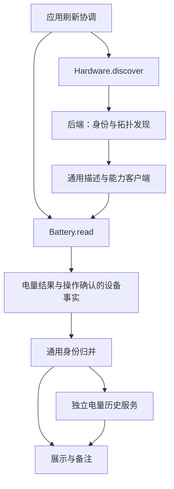

# 硬件适配与应用业务分层

状态：通用应用模型、独立能力读取已实现。2026-10-25。

当前接口用法见 [periph-hal](../crates/periph-hal/README.md)，适配流程与硬件证据见 [ADAPTATION](ADAPTATION.md)。本次完成的两项是：应用直接使用通用描述和身份证据；设备发现与电量读取分离。调度、事件推送和更多领域功能保留为后续工作。

## 1. 实际边界

| 模块 | 职责 | 不承担的职责 |
| --- | --- | --- |
| `crates/periph-hal/src/device.rs` | 设备描述、角色、身份凭据、路由、目标作用域、连接事实 | 电量历史、用户备注、界面文案 |
| `capability.rs` | 按组件、契约 ID、版本保存强类型能力；生命周期回调 | 字符串 RPC、任意 JSON 方法调用 |
| `hardware.rs` | 后端注册、被动枚举、设备发现、发现完成/失败范围、能力失效 | 应用身份记录和领域采样策略 |
| `battery.rs` | Battery 客户端、BatteryReader、独立读取结果 | 设备核心字段、历史及 UI 策略 |
| `windows/`、`protocol.rs` | 平台与协议实现、共享连接串行访问、纯报文函数 | 应用配置或 Slint |
| `src/model.rs` | 通用身份归并、记录 ID、备注、路由和连接 | 读取硬件、判断蓝牙路径前缀、电量状态 |
| `src/battery.rs` | 按设备记录/组件管理当前电量与历史 | 解释 USB、蓝牙或协议帧 |
| `src/hardware.rs`、`src/devices.rs` | 应用刷新流程：先发现，再显式调用需要的能力 | 旧 Reading 转换、按厂商选择身份规则 |
| `src/migration.rs` | 一次性解释 v1 配置并转换为 v2 | 运行时发现与身份判断 |
| `src/presentation.rs`、`src/app.rs` | 角色/链路展示、状态和 UI 操作 | 通过显示名称识别设备或构造协议命令 |

硬件库与应用是同一 workspace 内的独立 crate。公共设备及能力接口不暴露 Windows 类型；默认不启用平台后端，可选 serde 仅为通用描述提供序列化。

## 2. 调用流程

箭头表示调用或数据流。依赖上，后端与应用都使用 HAL 公共契约；设备核心不依赖电量领域。应用按自己的产品需求选择调用 Battery，其他应用可以选择完全不同的能力。

- `inventory()`：被动枚举元数据，不发送协议查询。
- `discover()`：识别设备、身份与接收器拓扑，提供能力客户端；不采样电量。必要的 UID、型号和配对/探活查询属于发现。
- `Battery::read()`：明确触发一次电量操作，可在不重新发现的情况下重复调用。
- `BatteryReading.facts`：提供本次操作确认的连接、名称和身份证据，调用方将其应用到设备事实后统一归并。

Windows HID 的发现和读取使用不同驱动入口；经典蓝牙后端仅在 Battery.read 时读取电量属性。已确认不提供电量的型号直接报告 Unsupported，不反复发送无意义的电量查询。

## 3. 通用身份与记录

应用保存 `DeviceDescriptor` 与不透明的记录 ID，不再强制每台设备具有 VID/PID、序列号或电池。角色标签只用于分类与展示，不决定身份，也不决定支持哪些能力。

身份匹配遵循以下约束：

- 凭据有命名空间和主体；USB VID 与蓝牙 company ID 不混为一谈。
- 优先使用本体 UID、地址和可靠序列号，其次位置与带来源作用域的路由。发现更强的证据不会改变已有记录 ID 或丢失备注。
- 强身份矛盾时，即使访问路径相同也不能接管旧记录。
- 重复序列号和名称伪序列号不会作为唯一身份，冲突在后续扫描中继续被保护。
- `DeviceDescriptor.target` 限定接收器下的逻辑目标，避免多个槽位复用同一接收器序列号；槽位路由不随其他设备上下线变化。
- 可靠证据可关联不同来源；归并保留各自访问路由与角色，不按相同名称或型号合并。
- 同身份的冲突备注保留为独立记录，供用户手动恢复。

身份服务返回本轮路由绑定及确认吸收的重复记录 ID。各领域服务按此重新绑定自己的历史；设备核心不需要知道电量、音频或摄像头的状态格式。

只有来源明确完成本轮发现时，缺席才可用于判离线。失败或未覆盖来源维持未知状态；另一来源的有效连接事实仍可生效。端点存在和外设在线是不同事实。

## 4. 能力与生命周期

能力按“组件键 + 契约 ID + 版本”注册，调用方通过 `get::<T>` 得到具体类型。新领域可以定义自己的方法、事件与会话，不扩充设备核心枚举或在所有设备上增加无关方法。

电量能力是实时客户端 `Battery`，状态是独立数据 `BatteryState`。创建和获取客户端不执行读取；能力版本为 power.battery v2。

- 同一客户端的读取串行执行；Windows HID 同一接收器的不同槽位共享访问锁。
- 显式 close、下一次发现、发现失败、Hardware 关闭会撤销旧电量客户端及其克隆。
- 已撤销客户端在执行 I/O 前报错，不能继续访问后来复用路由的新对象。
- Windows 读取会重新查找端点并检查可验证身份。没有本体身份的协议仍无法保证识别两次发现之间的重新配对。
- 关闭会等待已进入的同步读取完成；当前没有强制取消系统调用或并行发现。

新领域的实时客户端应实现 `Capability::invalidate`；不可变事实可以使用默认实现。媒体和连续输入使用领域专用数据会话，不把帧、样本和轨迹塞入发现快照。

## 5. 电量领域

设备记录不保存电量字段；电量领域按记录 ID 和组件键管理历史。

Value、Unsupported、Unavailable 分别表示有效值、明确不支持、本次暂不可用。读取失败不会转换成零或 Unsupported，也不会自动否定独立建立的连接事实。

同一轮多来源数据中，直接应答优先于没有采样时间的系统缓存，其余使用稳定顺序；失败来源不能抹除已选的有效值。展示值和保存历史使用同一选择结果，离线后仍保留最近有效读数。不同电池组件各自独立。

观察时间是应用读到结果的时间；设备未提供采样时间时不捏造该时间。系统缓存使用 SystemCache 来源，界面标记系统读数。

## 6. v1 到 v2 配置迁移

v2 保存通用设备描述、访问路由和独立的电量历史列表。旧字段 physical_id、kind、uid、vid/pid 等仅在 migration 模块读取；原有记录 ID 和备注保持不变，历史电量与时间拆入领域列表。

旧版本单接收器省略槽号、早期 session/epoch 位置键等知识也只在迁移阶段解释。运行时不通过 bt: 前缀猜来源，不按 VID 判断身份。

读取旧配置只在内存中转换；第一次保存之前创建精确原始字节备份 `settings.json.v1.bak`，然后原子替换为 v2。已有备份内容不同、原配置损坏或版本未知时拒绝覆盖。迁移和失败路径均有隔离临时目录测试，不访问用户真实配置。

## 7. 验证与扩展标准

本轮 workspace 共 63 项测试通过，fmt 与 Clippy 通过。独立库在 Linux 目标下关闭默认 features，以及启用 serde 的全部目标编译检查通过；这不代表已经实现 Linux 真机后端。

测试覆盖通用无电池设备、命名空间、可靠身份跨来源、重复序列号、槽位稳定、冲突备注、缺失强证据、失败范围、历史转移、v1 原字节备份，以及发现零采样、重复读取、旧客户端失效。总览与备注页面用脱敏示例渲染并检查。

扩展时按修改范围验证内聚与耦合：

| 需求 | 应修改 | 不应被迫修改 |
| --- | --- | --- |
| 同协议新增型号 | matcher / 型号数据、测试 | 应用身份、电量历史、通用核心 |
| 新协议实现已有能力 | 后端/驱动和对应测试 | 已有能力调用方与领域规则 |
| 新领域能力 | 独立契约、客户端、领域业务与展示、启动注册 | 核心设备枚举、其他领域驱动 |
| 备注或历史策略变化 | 对应应用服务 | 平台 I/O 和报文编解码 |
| 文案与格式变化 | presentation / Slint | 设备身份或协议实现 |

## 8. 后续范围

当前两项已经完成，剩余完善包括：后端独立调度、事件推送、可取消操作和更细的故障范围；完整组件关系与资源会话协商；有具体需求时增加 GATT、其他系统后端或真实媒体能力。

这些工作按实际需求和硬件验证推进。新增已有能力的适配现在即可复用接口，无需先把所有领域和调度方式实现完。
